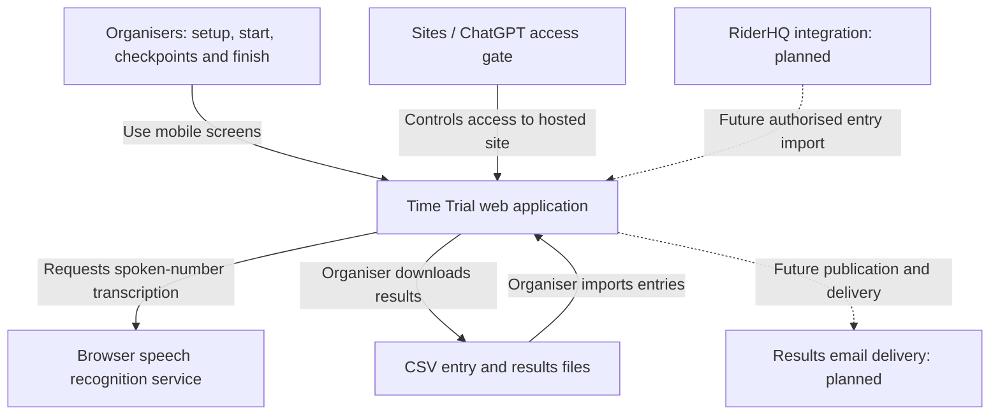
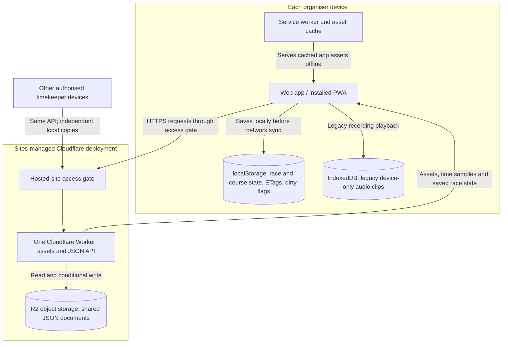
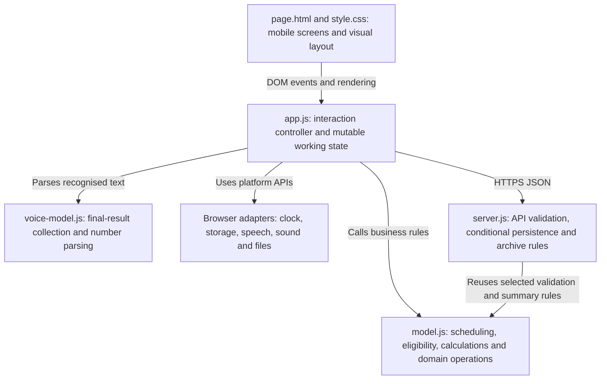
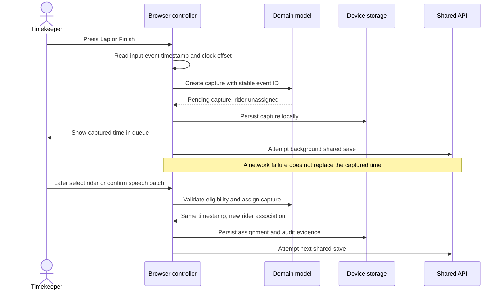
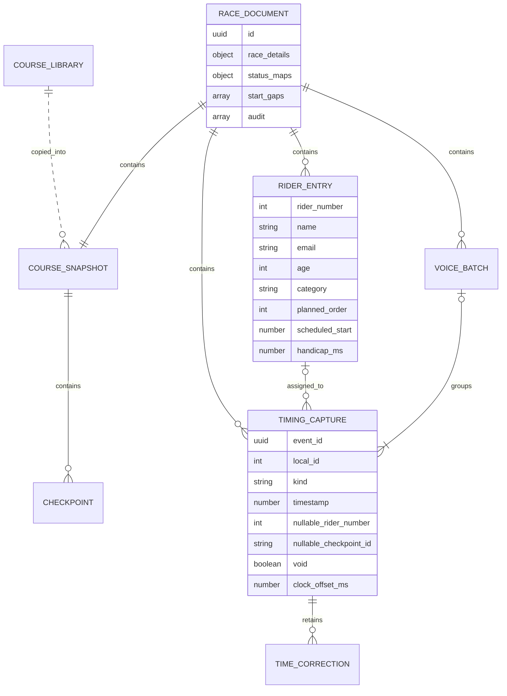
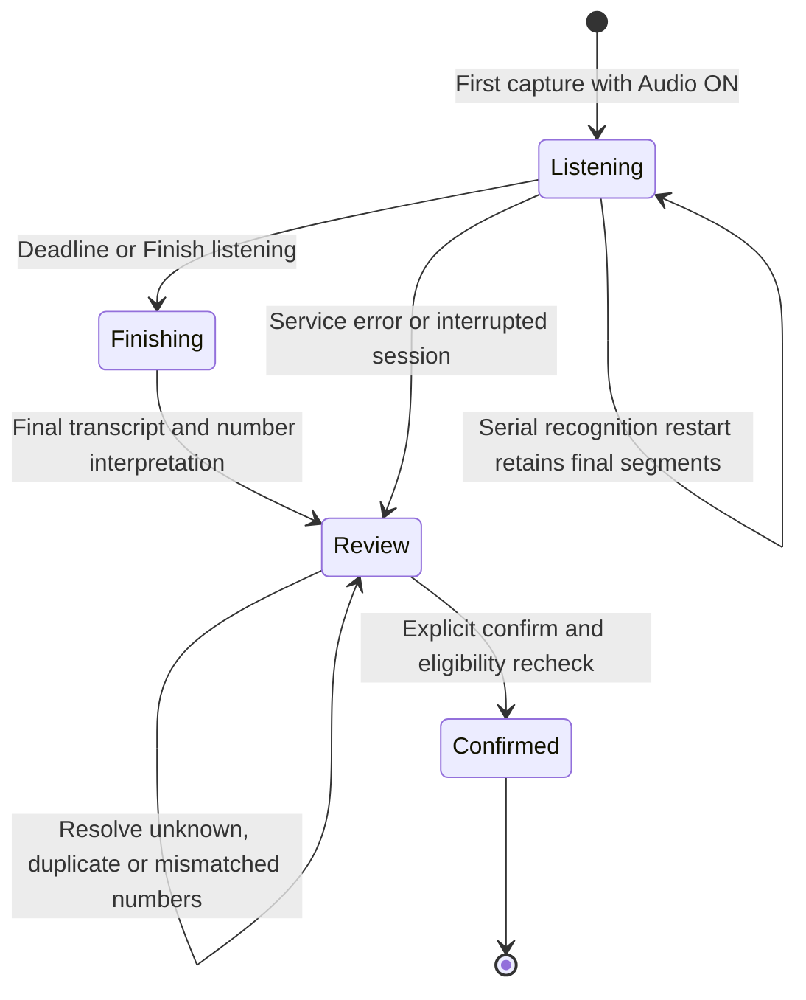
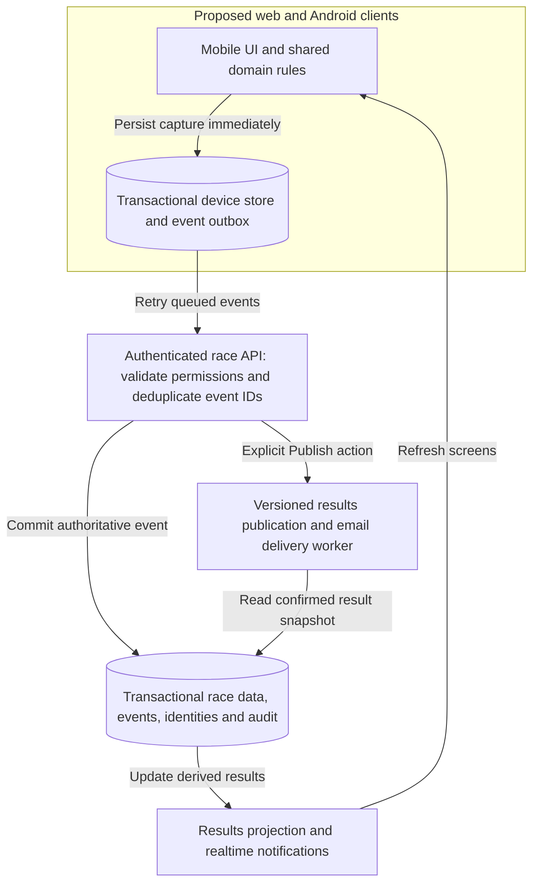

# Time Trial — Architecture and software design

Reviewed 26 October 2026. Implemented baseline: **Beta 0.9**, source commit `7eab099e0053b0ae84132c02e9de397149fba475`. Requirements baseline: **1.16**.

This document describes the code that exists, then separates recommended future architecture. It does not certify field timing accuracy or change the app. The implementation source is held in the Sites source repository; this project's GitHub repository holds the requirements and this design document. Do not assume an older GitHub web directory is the deployed source.

The diagrams use the C4 practice of progressively zooming from users/systems to applications and components, supplemented by sequence and data diagrams. Mermaid flowcharts are used for readability rather than claiming strict C4 notation. Arrows describe interactions/dependencies, not all possible function calls. Solid relationships are implemented; dashed relationships in the context diagram are planned.

## 1. System context — who uses it and what it connects to



The same web app serves all timekeepers. Start/Lap/Finish are different screens, not separate deployed applications. Android packaging is not yet implemented; the manifest and service worker make this an installable web app. CSV import/export work. RiderHQ and email delivery do not yet have configured production integrations. Browser speech may use a browser/vendor-managed online service; the app does not call a custom transcription API.

## 2. Applications, storage and deployment — current architecture



This is a **local-first client with a serverless backend**, using JSON documents in object storage. It is not currently a relational database architecture. The hosting manifest binds R2 and has no D1 database binding. No Supabase, React, Next.js, message broker or dedicated background email worker is present in this implementation.

Local state is the immediate working copy; R2 is the shared saved copy. Offline captures stay on their originating device until successfully uploaded. Service-worker caching covers the app assets, not API responses. Closing the app, device storage loss and microphone/network behaviour remain operational concerns: a local save is not a separate backup.

| API | Responsibility |
| --- | --- |
| `GET /api/time` | Server clock sample |
| `GET /api/races` | Active saved race list |
| `GET /api/races/:id` | Race state and ETag |
| `PUT /api/races/:id` | Validated, conditional full-document save |
| `POST /api/races/:id/archive` | Confirmed archive with version/start checks |
| `/api/courses` and course item routes | Shared course list, documents and archival |
| `GET /api/race-dashboard` | Derived summaries; optional archive markers |
| `GET /api/health` | Basic service/storage-binding availability |

R2 namespaces are `beta-v2/races/`, `beta-v2/courses/` and `beta-v2/race-identities/`. Identity claims help prevent concurrent creation of races with the same normalised name/date/minute. Race IDs remain stable UUIDs even though the UI hides them. Archival retains stored records; a user-facing restore workflow is not yet implemented.

## 3. Component design — where the behaviour lives



The build concatenates `model.js`, embedded static assets and `server.js` into `worker/index.js`; `scripts/build.sh` packages that generated entry point. Edit the source modules, not the generated file. The domain model runs in both browser and Worker, reducing duplicated calculation rules.

The current boundary is pragmatic: `app.js` combines rendering, microphone lifecycle, network sync, files, drafts and device storage. It is not a fully separated hexagonal/clean architecture. `model.js` is largely UI-independent, but its operations mutate the passed state and some use time/UUID globals, so it should not be described as entirely pure.

## 4. Timing sequence — why assignment delay does not affect the result



Start differs only at assignment: the selected next rider is attached immediately, then the UI advances. Lap/Finish first create an unassigned capture. Multiple presses produce separate captures even if their displayed tenths match. Speech and manual selection attach rider identity afterwards.

Clock mapping uses the input event timestamp, a performance-clock epoch mapping and the currently estimated server offset. Calibration takes five request/response samples, chooses the lowest estimated half-round-trip uncertainty, and repeats about every minute and on foreground return. Event records retain raw timestamp and offset/uncertainty evidence where supplied. The minimum-RTT midpoint method does **not** establish a hard 0.1-second bound; asymmetric network delay, hardware/input delay, drift and human reaction still need field validation. Resynchronisation does not retrospectively move historical captures.

Autostart records the scheduled start timestamp plus trigger time/lateness. The beta rejects a trigger over 100 ms late and requires manual intervention; that software threshold is not proof of physical start or cross-device accuracy. Audio countdowns use Web Audio scheduling; device sleep/backgrounding can invalidate operation.

## 5. Synchronisation and concurrent changes — current limitation

```mermaid
sequenceDiagram
  participant A as Starter device
  participant API as Worker API
  participant R as R2 race document
  participant B as Finish device
  A->>API: Load race
  API->>R: Read state and ETag v1
  API-->>A: State and v1
  B->>API: Load race
  API-->>B: State and v1
  A->>API: Save changed state with base v1
  API->>R: Conditional write if ETag is v1
  R-->>API: Accepted, new ETag v2
  API-->>A: Saved, v2
  B->>API: Save its changed state with base v1
  API-->>B: 409 conflict, retain local records
  Note over A,B: Explicit review/recovery; no automatic event merge
```

The client polls its selected race roughly every 2.5 seconds. It uploads the full race document when dirty. The server validates identity/shape and uses an R2 conditional write against the last known ETag. A stale write is rejected rather than silently overwriting another timekeeper's data. Identical full-document retries can succeed idempotently. This is **optimistic concurrency control**, not realtime collaborative event merging.

Race-list/dashboard summaries refresh around every 15 seconds; results on one device can update locally without waiting for that interval. Device-only queue selection, deferred selections and undo state are removed from the shared payload. Timing evidence, assignments, statuses, transcripts and audit data are shared with the race document.

Conflict recovery can preserve a local copy or review shared data. It is not a production reconciliation workflow that combines every concurrent start/checkpoint/finish automatically. This is the highest-priority architectural improvement for multiple organisers recording simultaneously.

## 6. Physical data design — what is actually stored



This is an aggregate/object diagram expressed with ER notation, **not SQL tables currently deployed**. A reusable Course is stored separately; each race embeds a snapshot so future course edits cannot change old distances. Checkpoints are ordered cumulative distances; repeated circuit visits are separate checkpoints.

The beta embeds rider-entry data in `riders[]`, including person name/email and race-specific bib, age, category, schedule and handicap. Its numeric `id` is currently the rider number within that race. The approved logical separation into reusable **Rider** and **RiderEntry** is not fully implemented. Cross-race analytics prefer available rider IDs, then email, with a conservative legacy fallback; this is not a complete identity-resolution system.

Captures may be unassigned. Corrections retain original values and before/after history; clearing marks a capture void. However, corrected `at` and assignment fields are mutable within a saved document. Therefore this design has audit evidence but is **not an immutable event store or complete event-sourced system**.

Derived results are calculated from current valid captures/statuses: actual duration, handicap-adjusted duration, positions, splits and speed. Invalid negative adjusted results are flagged and excluded from adjusted ranking rather than clamped. Closing marks remaining started riders DNF and waiting riders DNS. CSV is generated in the browser; an immutable publication store and email delivery tracking are still planned.

## 7. Speech design — independent from timing



The window is ten seconds after the latest press, capped at thirty seconds or twenty captures. One recognition owner holds the microphone. Browser final results are stored by result index; revisions replace that index. Raw final segment wording and interpreted whole numbers are retained separately. Confirmation is explicit; a valid batch is applied all-or-none within the client model, then persisted.

There is no new parallel raw-audio recorder in this path. Existing local audio clips may play from IndexedDB on the device that captured them. Transcripts travel with shared race state; legacy audio blobs do not. Exact acoustic pause detection over 0.5 seconds within one concatenated transcription remains unsupported. This needs a suitable audio/VAD/transcription pipeline or native capability, not a guessed split of an integer.

## 8. Design assessment and next architecture

| Area | Present design | Recommended next step |
| --- | --- | --- |
| Timing path | Input time captured before assignment/network | Keep this path; validate on real supported devices |
| Shared writes | Full-document CAS with explicit conflicts | Idempotent per-event ingestion and race-scoped reconciliation |
| Data model | Embedded race aggregate and course snapshots | Stable Rider/RiderEntry IDs; transactional constraints |
| Security | Hosting access gate; API shape/origin validation | Server-enforced organiser/station permissions and authenticated audit actor |
| Audit | Void/correction history inside mutable records | Append-only event/audit records and published result versions |
| Client structure | Large controller plus shared model | Separate UI, domain and storage/network/clock/speech adapters |
| Offline storage | localStorage snapshots and dirty flag | Transactional device store and durable event outbox |
| Updates | Polling | Realtime notifications with polling/reconnect recovery |
| Speech | Browser-dependent recognition | One capture pipeline with measured pause boundaries and retained audio |
| Publishing | Browser CSV; no email provider | Versioned result snapshot, delivery queue and retry-safe email worker |

Do not introduce microservices just to match a diagram. A modular application API with transactional storage is sufficient initially. Retain shared domain rules and separate side effects so browser and Android clients can implement the same race behaviour.



This diagram is **proposed**, not implemented or a commitment to a particular database, messaging service, Android toolkit or transcription provider. A durable publication job/outbox should prevent a race between storing the publication and requesting delivery. Realtime transport is an update mechanism; it must not become the source of the recorded timing instant.

## 9. Delivery, testing and evidence

Source modules -> `build-beta.py` -> generated Worker -> build/ESM validation -> source commit/archive -> saved Site version -> deployment. Runtime and pure-model tests cover scheduling, race closure, corrections, capture/voice assignment, CSV encoding, archives and CAS. Browser checks exercise real forms and bulk actions with isolated synthetic records. These tests do not establish microphone recognition quality, mobile battery/background reliability or field clock accuracy.

Reviewed sources: `worker/app.js`, `worker/model.js`, `worker/voice-model.js`, `worker/server.js`, `worker/sw.js`, `worker/manifest.webmanifest`, `build-beta.py`, `.openai/hosting.json`, build scripts and test files at the baseline commit.

Architecture notation reference: [C4 diagrams](https://c4model.com/diagrams), particularly [container](https://c4model.com/diagrams/container) and [deployment](https://c4model.com/diagrams/deployment) views. External references guide presentation; statements about this application are grounded in the reviewed code.
